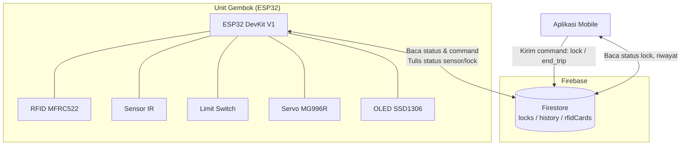
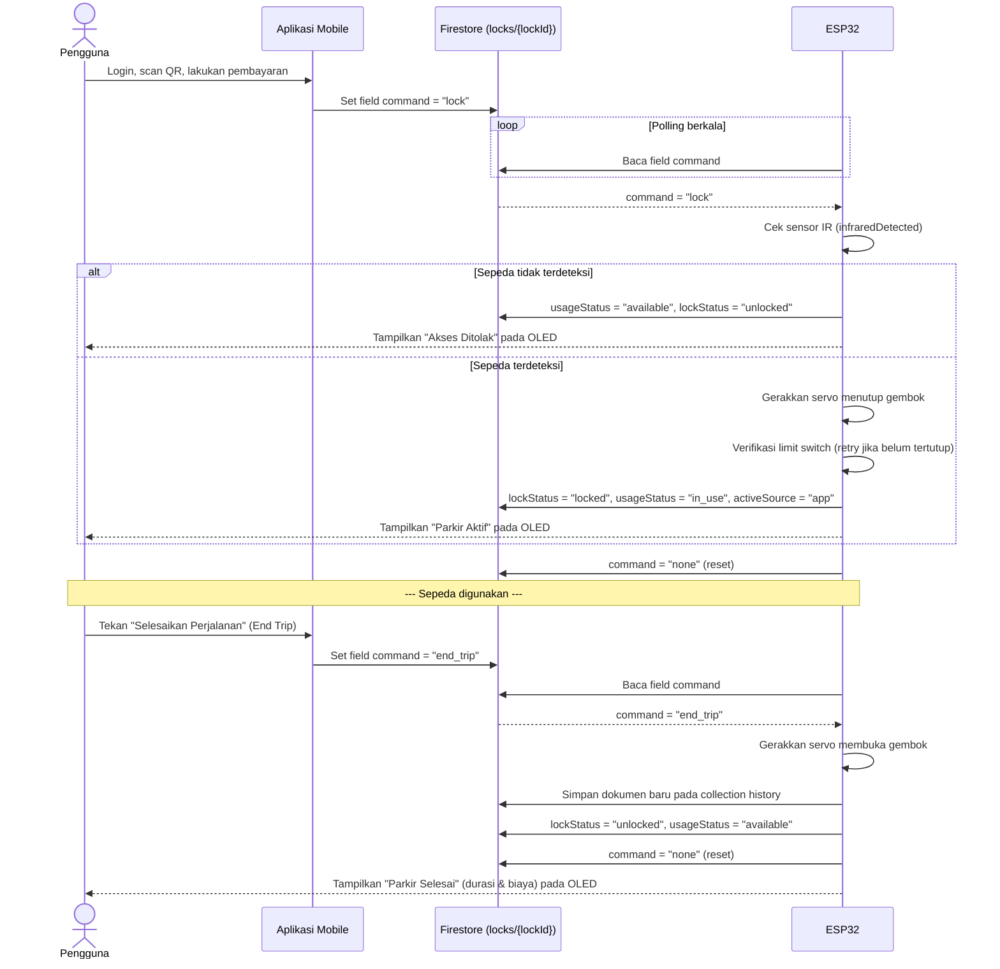
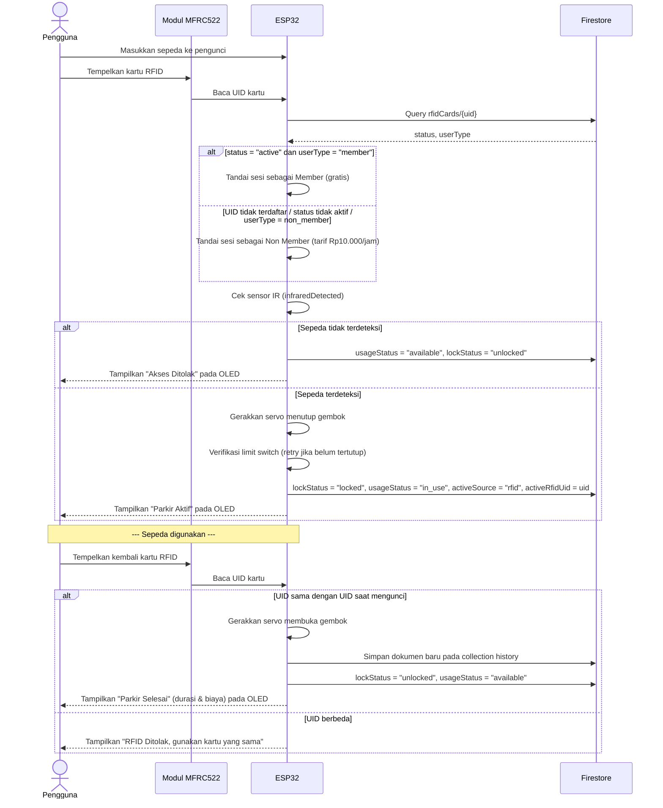
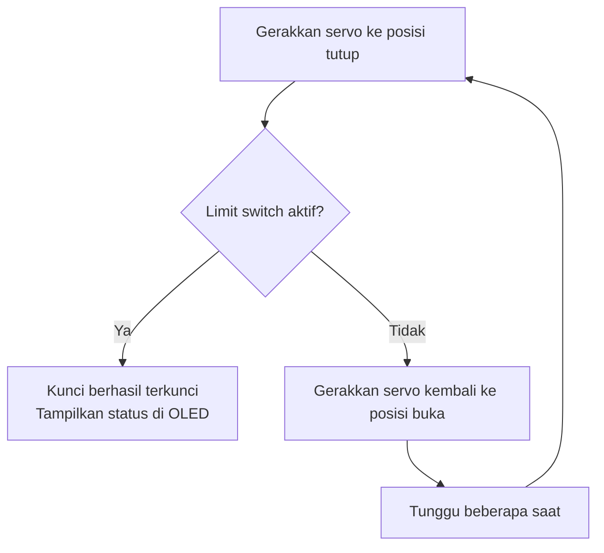
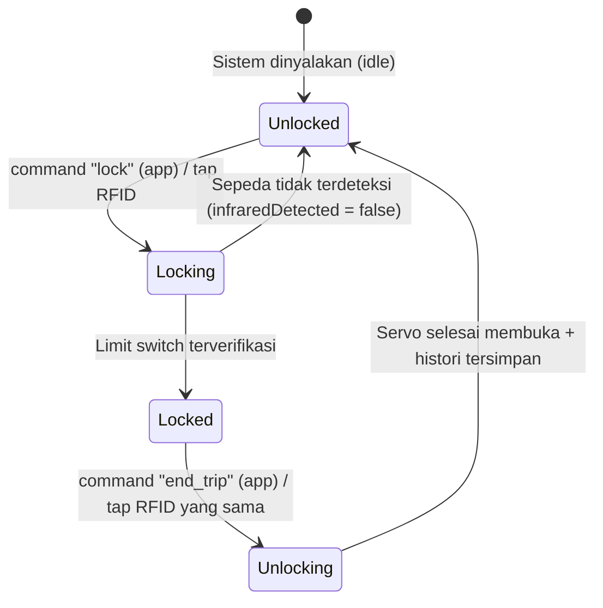

# Functional Specification Document (FSD)

**Sistem BICKE (Smart Bike Lock)**

*Juli 2026*

---


**Tabel 1. Atribut Dokumen**

| Atribut Dokumen | Keterangan |
|---|---|
| Nama Proyek | BICKE – Smart Bicycle Lock |
| Versi Dokumen | 1.0 |
| Tanggal | Juli 2026 |
| Platform Mikrokontroler | ESP32 DevKit V1 |
| Backend | Firebase Firestore |

---

# 1. Pendahuluan

## 1.1 Tujuan Dokumen
Dokumen ini menjelaskan spesifikasi fungsional sistem **BICKE**, yaitu sistem gembok sepeda pintar (*smart bicycle lock*) berbasis ESP32 yang terintegrasi dengan Firebase Firestore. Dokumen ini menjadi acuan mengenai cara kerja sistem, struktur data, komunikasi antar-komponen, dan kebutuhan fungsional sistem.

## 1.2 Ruang Lingkup
Dokumen ini mencakup:
- Spesifikasi perangkat keras (hardware) yang digunakan pada unit gembok.
- Logika kerja firmware ESP32.
- Struktur dan skema data pada Firebase Firestore.
- Alur komunikasi antara ESP32, Firestore, dan aplikasi mobile.
- Kebutuhan fungsional (*functional requirement*) sistem.

Aplikasi mobile hanya dibahas secara umum sebagai salah satu metode untuk mengoperasikan gembok (pengiriman perintah `lock` / `end_trip` ke Firestore). Implementasi antarmuka maupun logika internal aplikasi mobile berada di luar ruang lingkup dokumen ini.

## 1.3 Definisi dan Istilah

**Tabel 2. Definisi dan Istilah**

| Istilah | Keterangan |
|---|---|
| ESP32 | Mikrokontroler utama yang mengendalikan seluruh perangkat keras dan komunikasi dengan Firebase. |
| Firestore | Basis data NoSQL milik Firebase yang digunakan sebagai media penyimpanan dan komunikasi. |
| UID | *Unique Identifier* kartu RFID. |
| Member | Pengguna kartu RFID yang telah terdaftar dengan status `active` dan `userType = member` pada collection `rfidCards`. |
| Non Member | Pengguna kartu RFID yang tidak terdaftar, tidak aktif, atau terdaftar dengan `userType = non_member`. Dikenakan simulasi tarif. |
| `infraredDetected` | Status boolean hasil pembacaan sensor IR yang menandakan keberadaan sepeda pada mekanisme pengunci. |
| `lockStatus` | Status posisi gembok (`locked` / `unlocked`). |
| `usageStatus` | Status penggunaan slot parkir (`available` / `in_use`). |

---

# 2. Deskripsi Umum Sistem

BICKE adalah sistem gembok sepeda pintar berbasis ESP32 yang memungkinkan pengguna mengunci dan membuka sepeda melalui **dua metode independen**:

1. **Aplikasi mobile**, dengan mengirim perintah ke Firestore.
2. **Kartu RFID**, dengan menempelkan kartu pada modul pembaca RFID.

Firebase Firestore berperan sebagai media komunikasi (*command & status channel*) antara aplikasi dan ESP32, sekaligus sebagai media penyimpanan status sistem, data kartu RFID, dan riwayat penggunaan.

**Kondisi awal (idle):** gembok berada dalam keadaan **terbuka (unlocked)**. Servo tidak bergerak secara otomatis saat perangkat dinyalakan (*startup*), sehingga pengguna dapat memasukkan sepeda ke dalam mekanisme pengunci terlebih dahulu sebelum proses penguncian dimulai.

---

# 3. Spesifikasi Perangkat Keras (Hardware)

**Tabel 3. Spesifikasi Perangkat Keras (Hardware)**

| No | Komponen | Fungsi dalam Sistem |
|---|---|---|
| 1 | ESP32 DevKit V1 | Mikrokontroler utama untuk mengontrol seluruh sistem. |
| 2 | RFID MFRC522 | Membaca kartu/tag RFID sebagai metode akses pengguna. |
| 3 | Kartu RFID | Digunakan pengguna untuk membuka atau mengakhiri sesi parkir. |
| 4 | Servo MG996R | Menggerakkan mekanisme gembok untuk membuka dan menutup kunci. |
| 5 | Sensor IR (Infrared Obstacle) | Mendeteksi keberadaan sepeda pada area/mekanisme pengunci. |
| 6 | Limit Switch (NO) | Memverifikasi bahwa mekanisme gembok telah terkunci dengan benar. |
| 7 | OLED SSD1306 I2C 128x64 | Menampilkan status sistem, durasi, dan biaya parkir. |
| 8 | LM2596 Step Down Converter | Menstabilkan dan menurunkan tegangan catu daya untuk komponen. |
| 9 | Baterai 18650 (2x, disusun seri) | Sumber daya utama sistem, menghasilkan tegangan 7,4V/2000mAh sebelum distabilkan oleh LM2596. |

## 3.1 Rantai Catu Daya (Power Supply)

Sumber daya sistem berasal dari dua baterai 18650 yang disusun seri menghasilkan tegangan 7,4V. Tegangan tersebut diturunkan menjadi 5V melalui modul LM2596 Step Down Converter sebelum didistribusikan ke ESP32 dan Servo Motor MG996R. RFID Reader MFRC522 memperoleh tegangan 3,3V langsung dari pin regulator ESP32, sedangkan seluruh komponen menggunakan ground (GND) yang sama.

**Tabel 4. Koneksi Power Supply**

| No | Sumber / Modul | Keluaran | Digunakan Untuk |
|---|---|---|---|
| 1 | 2x Baterai 18650 | 7,4V / 2000mAh | Sumber daya utama |
| 2 | LM2596 Step Down | 5V | ESP32 dan Servo MG996R |
| 3 | ESP32 3.3V | 3,3V | Catu daya RFID Reader MFRC522 |
| 4 | Common Ground | GND | Menyatukan ground seluruh komponen |

## 3.2 Peta Pin (sesuai konfigurasi firmware)

**Tabel 5. Peta Pin ESP32**

| Komponen | Pin ESP32 |
|---|---|
| RFID SS | GPIO 5 |
| RFID RST | GPIO 4 |
| RFID SCK | GPIO 21 |
| RFID MISO | GPIO 22 |
| RFID MOSI | GPIO 23 |
| OLED SDA | GPIO 18 |
| OLED SCL | GPIO 19 |
| Alamat I2C OLED | 0x3C |
| Servo Signal | GPIO 13 |
| Sensor IR | GPIO 12 |
| Limit Switch | GPIO 14 |

---

# 4. Arsitektur Sistem

**Gambar 1. Arsitektur Sistem BICKE**



Komunikasi antara ESP32 dan aplikasi mobile bersifat **tidak langsung (asynchronous)**, seluruhnya melalui dokumen Firestore. ESP32 secara berkala melakukan *polling* terhadap dokumen `locks/{lockId}` untuk membaca perintah (`command`) dari aplikasi, dan menuliskan kembali status sensor serta status gembok ke dokumen yang sama.

---

# 5. Peran dan Struktur Data Firebase Firestore

Firebase Firestore digunakan untuk:
- Menyimpan status sistem dan sesi aktif (collection `locks`).
- Menyimpan daftar UID kartu RFID beserta status keanggotaannya (collection `rfidCards`).
- Menyimpan riwayat penggunaan (collection `history`).

> **Catatan:** Struktur basis data Firestore juga memiliki collection `notifications`. Collection tersebut tidak diakses maupun ditulis oleh firmware ESP32 (tidak ditemukan pada logika firmware), sehingga berada di luar cakupan fungsional dokumen ini dan diasumsikan digunakan oleh sisi aplikasi mobile.

## 5.1 Collection `users`
Satu dokumen per pengguna aplikasi mobile, dengan ID dokumen berupa ID pengguna (contoh: `E7VKJl01FEbxgOjs9QRjwaOdDSb2`). Collection ini dikelola oleh aplikasi mobile pada saat proses registrasi/login, dan **tidak dibaca maupun ditulis oleh firmware ESP32**; disertakan di sini karena telah didokumentasikan secara resmi sebagai bagian dari struktur data sistem BICKE pada laporan proyek.

**Tabel 6. Struktur Data Collection `users`**

| Field | Tipe | Keterangan |
|---|---|---|
| `email` | string | Alamat email pengguna aplikasi. |
| `gender` | string | Jenis kelamin pengguna. |
| `nama` | string | Nama pengguna. |
| `telp` | string | Nomor telepon pengguna. |
| `usia` | string | Usia pengguna. |

## 5.2 Collection `locks`
Satu dokumen per unit gembok, dengan ID dokumen sesuai `lockId` (contoh: `bike_001`).

**Tabel 7. Struktur Data Collection `locks`**

| Field | Tipe | Keterangan |
|---|---|---|
| `lockId` | string | ID unik unit gembok, contoh `"bike_001"`. |
| `lockStatus` | string | Status posisi gembok: `"locked"` / `"unlocked"`. |
| `usageStatus` | string | Status penggunaan slot: `"available"` / `"in_use"`. |
| `command` | string | Perintah dari aplikasi: `"lock"`, `"end_trip"`, atau `"none"`. Direset ke `"none"` setelah dieksekusi ESP32. |
| `commandUpdatedAt` | timestamp | Waktu terakhir field `command` diperbarui. |
| `infraredDetected` | boolean | Hasil pembacaan sensor IR (deteksi keberadaan sepeda), diperbarui berkala oleh ESP32. |
| `limitSwitchPressed` | boolean | Hasil pembacaan limit switch, diperbarui berkala oleh ESP32. |
| `activeSource` | string | Sumber sesi yang sedang aktif: `"app"`, `"rfid"`, atau `"none"`. |
| `activeUserId` | string | ID pengguna sesi aktif (`app_user`, `rfid_member`, `rfid_non_member`, atau kosong). |
| `activeRfidUid` | string | UID kartu RFID yang sedang digunakan pada sesi aktif (kosong jika sumber adalah `app`). |
| `userType` | string | Jenis pengguna sesi aktif: `"member"` / `"non_member"`. |
| `paid` | boolean | Status pembayaran sesi aktif. |
| `startTime` | timestamp / null | Waktu mulai sesi. |
| `latitude`, `longitude` | number | Koordinat lokasi unit gembok. |

## 5.3 Collection `rfidCards`
Satu dokumen per kartu RFID, dengan ID dokumen berupa UID kartu (contoh: `49D69006`).

**Tabel 8. Struktur Data Collection `rfidCards`**

| Field | Tipe | Keterangan |
|---|---|---|
| `uid` | string | UID kartu RFID. |
| `status` | string | Status kartu: `"active"` (kartu berlaku) atau nilai lain (dianggap tidak valid). |
| `userType` | string | `"member"` atau `"non_member"`, menentukan apakah dikenakan tarif. |
| `owner` | string | Nama pemilik kartu. |
| `linkedBike` | string | ID unit gembok yang terkait dengan kartu. |
| `registeredAt` | timestamp | Waktu pendaftaran kartu. |
| `lastUsedAt` | timestamp / null | Waktu terakhir kartu digunakan. |

## 5.4 Collection `history`
Satu dokumen dibuat untuk setiap sesi parkir yang telah **selesai** (dokumen baru dibuat oleh ESP32 pada saat proses *unlock* akhir, bukan pada saat mengunci).

**Tabel 9. Struktur Data Collection `history`**

| Field | Tipe | Keterangan |
|---|---|---|
| `lockId` | string | ID unit gembok terkait. |
| `source` | string | Sumber sesi: `"app"` atau `"rfid"`. |
| `userType` | string | `"member"` atau `"non_member"`. |
| `userId` | string | `app_user`, `rfid_member`, atau `rfid_non_member`. |
| `ownerName` | string | Nama yang tercatat pada sesi (`App User`, `RFID Member`, `RFID Non Member`). |
| `rfidUid` | string | UID kartu RFID yang digunakan (kosong jika sumber `app`). |
| `durationSeconds` | integer | Durasi sesi dalam detik. |
| `durationMinutes` | integer | Durasi sesi dalam menit (pembulatan ke atas). |
| `ratePerHour` | integer | Tarif per jam yang berlaku (`0` untuk member, `10000` untuk non member). |
| `totalPrice` | integer | Total biaya sesi. |
| `status` | string | Status dokumen histori, bernilai `"completed"`. |

---

# 6. Alur Kerja Sistem

## 6.1 Metode 1 — Melalui Aplikasi Mobile

Pada metode ini, aplikasi mengirim perintah ke Firestore, dan seluruh proses fisik (pengecekan sensor, penguncian, verifikasi) dieksekusi oleh ESP32.

**Gambar 2. Diagram Alur Kerja Metode Aplikasi Mobile**



**Catatan implementasi:**
- Perintah `command` bernilai `"lock"` atau `"unlock"` sama-sama diproses ESP32 sebagai permintaan memulai sesi (mengunci gembok); `"end_trip"` digunakan untuk mengakhiri sesi.
- Sesi melalui aplikasi selalu dianggap `userType = non_member` dan `paid = true`, sehingga dikenakan tarif simulasi Rp10.000/jam.

## 6.2 Metode 2 — Melalui Kartu RFID

**Gambar 3. Diagram Alur Kerja Metode Kartu RFID**



**Catatan implementasi:**
- Selama sesi RFID aktif, jika kartu berbeda ditempelkan, sistem menolak dan tetap meminta kartu yang sama digunakan untuk mengakhiri sesi.
- Selama sesi RFID aktif, sistem tidak dapat diakses melalui metode aplikasi, dan sebaliknya (kedua metode saling eksklusif berdasarkan field `activeSource`).

## 6.3 Mekanisme Verifikasi Penguncian (Limit Switch)

Proses penutupan gembok tidak langsung dianggap berhasil hanya karena servo selesai bergerak. ESP32 melakukan verifikasi melalui limit switch dengan mekanisme percobaan ulang (*retry*):

**Gambar 4. Mekanisme Verifikasi Limit Switch (Retry)**



## 6.4 Diagram Status Gembok

**Gambar 5. Diagram Status Gembok**



## 6.5 Arsitektur Eksekusi Firmware (Non-blocking Loop)

Dari sisi arsitektur eksekusi, firmware BICKE tidak menggunakan FreeRTOS task terpisah, melainkan mengadopsi **non-blocking polling loop** pada fungsi `loop()` utama Arduino. Pendekatan ini dipilih karena pustaka komunikasi Firebase Firestore bersifat sinkron (*blocking*) pada level HTTP request, sehingga penggunaan `delay()` panjang akan menghentikan seluruh proses pembacaan sensor lainnya. Untuk menghindari hal tersebut, ESP32 menerapkan penjadwalan kooperatif berbasis `millis()`, sebagaimana dirangkum pada Tabel 11.

**Tabel 10. Interval Eksekusi Fungsi pada Loop Utama**

| Fungsi | Interval | Mekanisme |
|---|---|---|
| `updateFirebaseSensorStatus()` | Setiap 2 detik | Dibatasi dengan perbandingan `millis() - lastUpdate >= 2000` sebelum mengirim data ke Firestore. |
| Pembaruan tampilan durasi/biaya pada OLED (saat parkir aktif) | Setiap 1 detik | Dibatasi dengan pola `millis()` yang sama untuk menghindari refresh berlebihan. |
| `checkAppCommand()` | Setiap iterasi loop (tanpa pembatasan interval) | Memanggil `Firebase.Firestore.getDocument()` pada setiap siklus `loop()`; berpotensi menjadi beban jaringan lebih tinggi dibanding dua fungsi lainnya. |
| Pembacaan RFID (`rfidTerdeteksi()`) | Setiap iterasi loop | Non-blocking; hanya memproses lebih lanjut apabila kartu terdeteksi. |

Dengan pola ini, ESP32 tetap dapat membaca RFID Reader dan sensor IR secara responsif tanpa terhambat oleh proses komunikasi jaringan, meskipun seluruh proses berjalan pada satu thread eksekusi (*single-threaded cooperative multitasking*), bukan multitasking preemptive seperti pada FreeRTOS. `delay()` tetap digunakan pada firmware, namun terbatas pada jeda pendek yang disengaja untuk kebutuhan tampilan/transisi (misalnya saat servo bergerak mengunci atau membuka gembok), bukan sebagai mekanisme penjadwalan utama.

---

# 7. Logika Perhitungan Biaya

Biaya dihitung hanya untuk pengguna dengan `userType = non_member` (baik dari aplikasi maupun RFID yang tidak terdaftar sebagai member). Pengguna `member` dikenakan biaya Rp0 (gratis).

**Tabel 11. Parameter Perhitungan Biaya**

| Parameter | Nilai |
|---|---|
| Tarif per jam | Rp10.000 |
| Metode pembulatan durasi | Ke atas per jam (durasi kurang dari 1 jam tetap dihitung 1 jam) |
| Biaya member | Rp0 |

**Formula:**
```
durasi_jam = ceil(durasi_detik / 3600), minimum 1 jam
biaya = (userType == "member") ? 0 : durasi_jam × 10.000
```

---

# 8. Functional Requirement

**Tabel 12. Daftar Functional Requirement**

| ID | Deskripsi Kebutuhan | Sumber |
|---|---|---|
| FR-01 | Sistem harus berada pada kondisi gembok terbuka (unlocked) saat pertama kali dinyalakan, tanpa pergerakan servo otomatis. | Kondisi awal sistem |
| FR-02 | Sistem harus membaca status sensor IR secara berkala dan menuliskannya ke field `infraredDetected` pada Firestore. | Metode 1 & 2 |
| FR-03 | Sistem harus menolak proses penguncian apabila sensor IR tidak mendeteksi keberadaan sepeda. | Metode 1 & 2 |
| FR-04 | Sistem harus dapat menerima perintah `lock`/`unlock` dan `end_trip` dari aplikasi melalui field `command` pada dokumen Firestore `locks`. | Metode 1 |
| FR-05 | Sistem harus membaca UID kartu RFID melalui modul MFRC522 saat kartu ditempelkan. | Metode 2 |
| FR-06 | Sistem harus memeriksa UID kartu terhadap collection `rfidCards` untuk menentukan status Member/Non Member. | Metode 2 |
| FR-07 | Sistem harus menerapkan simulasi biaya Rp10.000/jam untuk pengguna Non Member (baik dari aplikasi maupun RFID yang tidak terdaftar sebagai member). | Metode 1 & 2 |
| FR-08 | Sistem harus menggerakkan servo untuk mengunci gembok setelah proses identifikasi (QR/pembayaran pada aplikasi, atau pembacaan UID pada RFID) selesai dan sepeda terdeteksi. | Metode 1 & 2 |
| FR-09 | Sistem harus memverifikasi status terkunci melalui limit switch, dan mengulang proses penutupan apabila limit switch belum aktif. | Metode 1 & 2 |
| FR-10 | Sistem harus menolak pengakhiran sesi RFID apabila UID kartu yang ditempelkan berbeda dari UID kartu yang digunakan saat mengunci. | Metode 2 |
| FR-11 | Sistem harus mencegah sesi baru dimulai apabila terdapat sesi lain yang sedang aktif (`activeSource` bukan `"none"`). | Metode 1 & 2 |
| FR-12 | Sistem harus menggerakkan servo untuk membuka gembok saat sesi diakhiri (End Trip pada aplikasi, atau tap ulang kartu RFID yang sama). | Metode 1 & 2 |
| FR-13 | Sistem harus menyimpan riwayat penggunaan (durasi dan biaya) ke collection `history` pada Firestore setiap kali sesi selesai. | Metode 1 & 2 |
| FR-14 | Sistem harus menampilkan status sistem (status gembok, durasi, dan biaya) secara real-time pada layar OLED. | Semua metode |
| FR-15 | Sistem harus memperbarui status `usageStatus` dan `lockStatus` pada Firestore setiap terjadi perubahan kondisi gembok. | Semua metode |

---

# 9. Tools dan Development Environment

Pengembangan firmware sistem BICKE menggunakan sejumlah tools dan pustaka (library) sebagaimana dirangkum pada Tabel 13 dan Tabel 14. Bagian ini disertakan agar FSD selaras dengan lingkungan pengembangan yang telah digunakan pada implementasi aktual sistem.

**Tabel 13. Tools Pengembangan**

| No | Tools | Fungsi |
|---|---|---|
| 1 | Visual Studio Code | Menulis dan mengelola kode program. |
| 2 | PlatformIO | Build, upload, dan manajemen library ESP32. |
| 3 | Arduino Framework | Dasar pemrograman ESP32. |
| 4 | Firebase Firestore | Penyimpanan data dan komunikasi real-time antara ESP32 dan aplikasi mobile. |
| 5 | Firebase Console | Mengelola dan memantau data pada Firebase Firestore. |
| 6 | Serial Monitor | Menampilkan log dan membantu proses debugging ESP32. |

**Tabel 14. Library Pendukung Firmware**

| No | Library | Fungsi |
|---|---|---|
| 1 | MFRC522 | Membaca UID kartu RFID melalui modul RFID Reader MFRC522. |
| 2 | ESP32Servo | Mengontrol servo MG996R untuk membuka dan menutup gembok. |
| 3 | Adafruit SSD1306 | Mengontrol tampilan OLED SSD1306 I2C. |
| 4 | Adafruit GFX | Mendukung tampilan teks dan grafis pada OLED. |
| 5 | WiFi | Menghubungkan ESP32 ke jaringan internet. |
| 6 | Firebase ESP Client | Menghubungkan ESP32 dengan Firebase Firestore. |

---

# 10. Batasan Sistem

- Kedua metode akses (aplikasi dan RFID) bersifat saling eksklusif; hanya satu sesi yang dapat aktif dalam satu waktu untuk satu unit gembok, ditentukan oleh field `activeSource`.
- Sesi yang dimulai melalui satu metode hanya dapat diakhiri melalui metode yang sama (khusus RFID, harus menggunakan kartu yang identik).
- Simulasi biaya bersifat perhitungan internal sistem (dicatat pada Firestore); dokumen ini tidak mencakup mekanisme pembayaran aktual (payment gateway).
- Dokumen ini tidak membahas implementasi antarmuka maupun logika internal aplikasi mobile, kecuali pada titik interaksinya dengan Firestore (pengiriman `command`).
- Sistem sepenuhnya bergantung pada ketersediaan koneksi internet/WiFi untuk proses autentikasi dan sinkronisasi data; tidak tersedia mode operasi offline.
- Implementasi dan pengujian sistem saat ini difokuskan pada skala prototype (satu unit gembok, `bike_001`) dalam lingkungan pengujian terbatas, belum mencakup deployment multi-unit atau kondisi lapangan yang sebenarnya.

---

# 11. Non-Functional Requirement

Bagian ini mendefinisikan kebutuhan non-fungsional sistem BICKE, mencakup aspek performa, keandalan, keamanan, efisiensi daya, skalabilitas, dan maintainability. Target/acuan pada beberapa poin diturunkan langsung dari hasil pengujian empiris yang telah dilakukan terhadap prototype sistem, sehingga bersifat terukur dan bukan sekadar aspirasi kualitatif.

**Tabel 15. Daftar Non-Functional Requirement**

| ID | Kategori | Deskripsi Kebutuhan | Target / Acuan |
|---|---|---|---|
| NFR-01 | Performa (RFID) | Sistem harus mampu membaca UID kartu RFID secara stabil pada jarak baca dekat modul reader. | Tingkat keberhasilan 5/5 percobaan pada jarak baca 0–0,5 cm. |
| NFR-02 | Performa (Sensor IR) | Sistem harus mampu mendeteksi keberadaan sepeda secara konsisten pada rentang jarak operasional sensor. | Tingkat keberhasilan 5/5 percobaan pada jarak 2–5 cm. |
| NFR-03 | Keandalan (Mekanisme Kunci) | Servo harus mampu mengunci gembok dan mengaktifkan limit switch secara konsisten, dilengkapi mekanisme retry otomatis apabila limit switch belum aktif. | Tingkat keberhasilan 5/5 percobaan pada delay tutup servo 900–910 ms. |
| NFR-04 | Ketersediaan / Konektivitas | Sistem bergantung pada koneksi WiFi/internet aktif untuk autentikasi dan sinkronisasi data. | Tidak ada mode operasi offline; keterlambatan sinkronisasi dapat terjadi akibat kualitas jaringan. |
| NFR-05 | Keamanan Data | Data lokasi (`latitude`/`longitude`), UID kartu RFID, dan data pribadi pengguna aplikasi (email, telepon, usia) yang tersimpan pada Firestore harus dilindungi dari akses tidak sah. | Penerapan Firestore Security Rules yang membatasi akses baca/tulis sesuai peran pengguna (di luar cakupan teknis dokumen ini, namun wajib diterapkan sebelum produksi). |
| NFR-06 | Efisiensi Daya | Sistem harus dapat beroperasi menggunakan sumber daya baterai tanpa memerlukan pengisian ulang dalam waktu yang terlalu singkat. | Ditenagai 2x baterai 18650 (7,4V/2000mAh); firmware non-blocking membatasi frekuensi pembaruan status sensor ke Firebase setiap 2 detik untuk mengurangi konsumsi daya akibat komunikasi jaringan. |
| NFR-07 | Skalabilitas | Struktur data Firestore harus dapat diperluas untuk mendukung lebih dari satu unit gembok. | Skema collection `locks` sudah mendukung banyak dokumen per `lockId`, namun implementasi dan pengujian baru dilakukan untuk satu unit (`bike_001`). |
| NFR-08 | Maintainability | Firmware harus disusun secara modular per fungsi agar mudah dikembangkan dan diperbaiki. | Struktur file terpisah per modul (`rfid_reader`, `sensors`, `servo_lock`, `display_oled`, `app_firebase`). |
| NFR-09 | Keselamatan (Fail-safe) | Sistem sebaiknya memiliki mekanisme fail-safe apabila koneksi terputus saat servo sedang bergerak menutup, agar gembok tidak macet pada posisi yang tidak diketahui. | **Belum diimplementasikan** pada versi prototype ini; direkomendasikan sebagai perbaikan pada pengembangan berikutnya (Version 2.0). |
